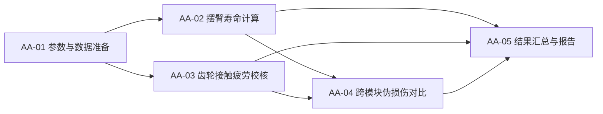

# Plan(流程设计)

## 流程总览
1. AA-01 参数与数据准备
2. AA-02 关节摆臂疲劳寿命计算
3. AA-03 齿轮接触疲劳校核
4. AA-04 跨模块伪损伤对比
5. AA-05 结果汇总与报告交付

## 依赖说明
- AA-02 与 AA-03 互不依赖,均只依赖 AA-01,可并行。
- AA-04 必须等 AA-02 和 AA-03 都完成。
- AA-05 汇总三者结果。

---
